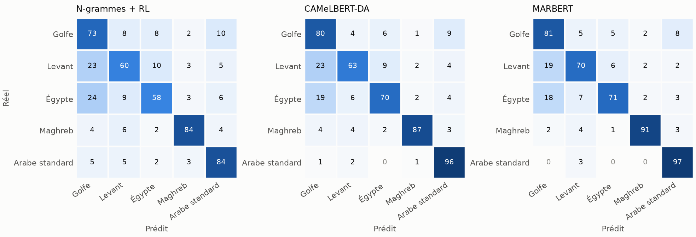
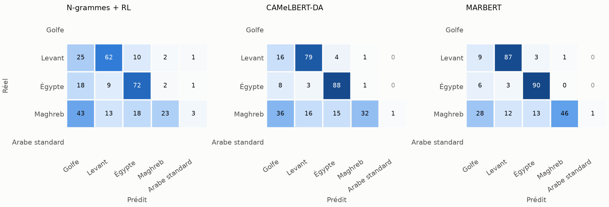
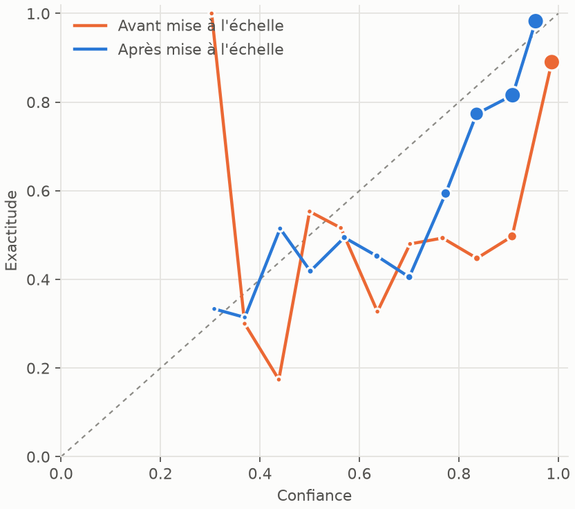

# Lahja : rapport d'évaluation

[English version](evaluation.md)

Corpus `open`. Le modèle retenu pour la démo est **MARBERT**, choisi sur le jeu de validation. Sur le jeu de test, il atteint une macro-F1 de 80,8 %, contre 70,8 % pour la référence en n-grammes de caractères, soit 10,0 points de plus. Tous les chiffres ci-dessous sortent de `make evaluate` et sont réécrits à chaque exécution.

## Seuils d'acceptation

Le modèle n'est exporté et publié que si les trois seuils sont tenus.

| critère | seuil | mesuré | tenu |
| :--- | :--- | ---: | :--- |
| gain du modèle affiné sur la référence (macro-F1 en test) | ≥ 5 points | 10,0 pts | oui |
| macro-F1 perdue à la quantification int8 | ≤ 1 point | 0,32 pt | oui |
| latence de la démo, 95e centile, CPU | < 300 ms par phrase | 24,0 ms | oui |

Les trois seuils sont tenus : `make publish` copie le modèle quantifié dans `models/release/`.

## Les trois modèles

Mêmes données d'entraînement, même découpage, même normalisation. Le jeu de test ne partage aucune phrase source, aucune émission et aucun mot-vedette avec l'entraînement. Les deux lignes ONNX correspondent au modèle retenu après export, en flottants 32 bits puis en entiers 8 bits (c'est cette dernière version que la démo fait tourner).

| modèle | macro-F1 test (même domaine) | macro-F1 tweets (hors domaine) | exactitude (test) | ECE test |
| :--- | ---: | ---: | ---: | ---: |
| N-grammes + RL | 70,8 | 58,7 | 69,6 | 0,055 |
| CAMeLBERT-DA | 78,1 | 70,8 | 76,7 | 0,074 |
| MARBERT ★ | 80,8 | 78,7 | 79,6 | 0,077 |
| ONNX fp32 | 80,7 | 78,7 | 79,5 | 0,078 |
| ONNX int8 | 80,4 | 78,5 | 79,2 | 0,074 |

★ retenu pour la démo. Macro-F1 en validation : CAMeLBERT-DA 81,3, MARBERT 84,0.

Chaque modèle affiné a aussi été entraîné avec d'autres graines, sans rien changer d'autre. Moyenne ± écart-type sur ces exécutions :

| modèle | graines | macro-F1 test (même domaine) | macro-F1 tweets (hors domaine) |
| :--- | ---: | ---: | ---: |
| CAMeLBERT-DA | 3 | 78,6 ± 0,5 | 71,3 ± 0,5 |
| MARBERT | 3 | 80,7 ± 0,3 | 76,3 ± 2,4 |

### Précision, rappel et F1 par classe (test)

| classe | N-grammes + RL P / R / F1 | CAMeLBERT-DA P / R / F1 | MARBERT P / R / F1 |
| :--- | ---: | ---: | ---: |
| Golfe | 58 / 73 / 65 | 64 / 80 / 71 | 68 / 81 / 74 |
| Levant | 76 / 60 / 67 | 86 / 63 / 73 | 85 / 70 / 77 |
| Égypte | 69 / 58 / 63 | 77 / 70 / 73 | 81 / 71 / 76 |
| Maghreb | 86 / 84 / 85 | 92 / 87 / 89 | 91 / 91 / 91 |
| Arabe standard | 66 / 84 / 74 | 74 / 96 / 84 | 78 / 97 / 87 |

Chaque ligne fait 100 : la part d'une classe réelle envoyée vers chaque classe prédite.

### Score en test selon le corpus d'origine

Le jeu de test mêle trois corpus de registres très différents. Macro-F1 sur les classes qui comptent au moins 20 phrases de test dans chaque corpus (Maghreb écarté de SADA, 2 phrases) :

| modèle | FLORES-200 (n = 1 248) | Lahga (n = 323) | SADA (n = 1 178) |
| :--- | ---: | ---: | ---: |
| N-grammes + RL | 68,9 | 62,3 | 52,7 |
| CAMeLBERT-DA | 83,2 | 68,9 | 60,1 |
| MARBERT | 84,7 | 81,3 | 64,2 |

FLORES-200 contient des phrases soutenues traduites de Wikipédia en anglais, SADA des dialogues d'émissions de télévision, Lahga de courtes phrases d'exemple tirées d'un dictionnaire.

## Tests hors domaine

Ces jeux viennent de sources que les modèles n'ont jamais vues à l'entraînement. Prédire une classe absente du jeu (l'arabe standard, par exemple) compte comme une erreur, et la macro-F1 fait la moyenne sur les classes présentes.

### tweets (hors domaine)

Tweets étiquetés par pays selon QADI (QCRI), 1 000 par classe, tirés au hasard parmi ceux qui font de 3 à 60 mots après normalisation. Le corpus disponible avec son texte ne couvre que l'Égypte, le Liban, la Libye, le Maroc et le Soudan (écarté) : il n'y a donc pas de classe Golfe ici. L'étiquette d'un tweet est le pays de son auteur, pas une lecture du texte, et certains sont en arabe standard. Aucun texte de tweet n'est publié, seulement les scores.

| modèle | macro-F1 | F1 Levant | F1 Égypte | F1 Maghreb |
| :--- | ---: | ---: | ---: | ---: |
| N-grammes + RL | 58,7 | 67,8 | 71,8 | 36,5 |
| CAMeLBERT-DA | 70,8 | 79,8 | 84,8 | 47,8 |
| MARBERT | 78,7 | 86,3 | 87,5 | 62,4 |

MADAR ne fait pas partie de cette exécution : sa licence impose un téléchargement manuel (voir le README). Une fois les fichiers dans `data/raw/madar/`, `make evaluate` l'ajoute ici.

## Calibration

Erreur de calibration attendue (ECE, 15 intervalles) du modèle retenu sur le jeu de test : 0,140 avant mise à l'échelle de la température, 0,077 après. La température est ajustée sur la validation seule (T = 1,66 pour le modèle PyTorch, 1,54 pour le modèle int8 de la démo). Elle change la confiance, jamais la classe prédite.

## Quantification

Quantification dynamique des poids en int8 avec ONNX Runtime, après fusion des opérations d'attention et de normalisation. Macro-F1 en test : 80,73 % en fp32, 80,41 % en int8, soit 0,32 point de perte. Le fichier passe de 621 Mo à 156 Mo.

## Latence sur CPU

300 phrases du jeu de test envoyées une par une, ONNX Runtime limité à 2 threads, ce que fournit un Space Hugging Face gratuit sur CPU (processeur : AMD Ryzen 5 5600G with Radeon Graphics). Le chemin API couvre toute la requête : validation, normalisation, découpage en tokens, inférence et JSON.

| chemin | p50 (ms) | p95 (ms) |
| :--- | ---: | ---: |
| API `POST /predict` | 12,2 | 24,0 |
| modèle seul (int8) | 9,2 | 20,4 |
| API `POST /predict` avec `explain` (influence des mots) | 100,0 | 590,4 |
| référence (scikit-learn) | 0,5 | 0,6 |

L'influence des mots retire chaque mot à tour de rôle et mesure ce que perd la classe prédite, soit un passage de plus par mot, regroupés en un seul lot. Le seuil porte sur la prédiction seule.

## Ce que regarde la référence

N-grammes de caractères au plus fort poids dans la régression logistique, pour chaque classe, bords de mot retirés et doublons fusionnés (les n-grammes `char_wb` portent les espaces autour du mot).

| classe | n-grammes |
| :--- | :--- |
| Golfe | `وش` `لا` `ايش` `يا` `مو` `اب` `ما` `هذ` `اللي` `تي` |
| Levant | `بت` `يلي` `هيك` `عم` `رح` `عال` `هيد` `نو` `مش` `حك` |
| Égypte | `دي` `بت` `ده` `ات` `بي` `هت` `وا` `لو` `ليه` `زي` |
| Maghreb | `اش` `كي` `كت` `باش` `ديا` `ديال` `فال` `برش` `بش` `تي` |
| Arabe standard | `قد` `التي` `ان` `لتي` `او` `لم` `كما` `به` `ائ` `الذي` |

## Entraînement

| modèle | matériel | durée | meilleure époque | macro-F1 en validation par époque |
| :--- | :--- | :--- | ---: | :--- |
| CAMeLBERT-DA | AMD Radeon Graphics (gfx1200, ROCm 7.2) | 2 min | 3 | 79,5, 80,9, 81,3 |
| MARBERT | AMD Radeon Graphics (gfx1200, ROCm 7.2) | 4 min | 3 | 82,0, 82,4, 83,9 |

Affinage : modèle complet, 3 époques, lots de 32, AdamW avec un taux d'apprentissage de 3e-5, montée linéaire sur 6 % des pas puis décroissance linéaire, weight decay de 0,01, précision mixte, entropie croisée pondérée par l'inverse de la fréquence des classes, graine 13. L'époque conservée est la meilleure en validation. Référence : TF-IDF sur n-grammes de caractères de 2 à 5 (`char_wb`), régression logistique à poids de classes équilibrés, C = 10 choisi en validation.

