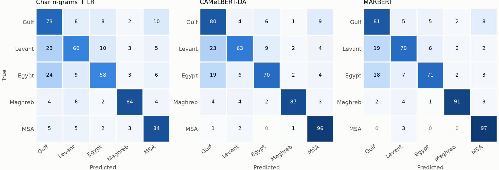
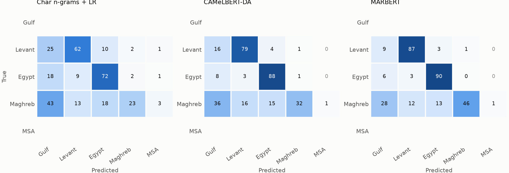
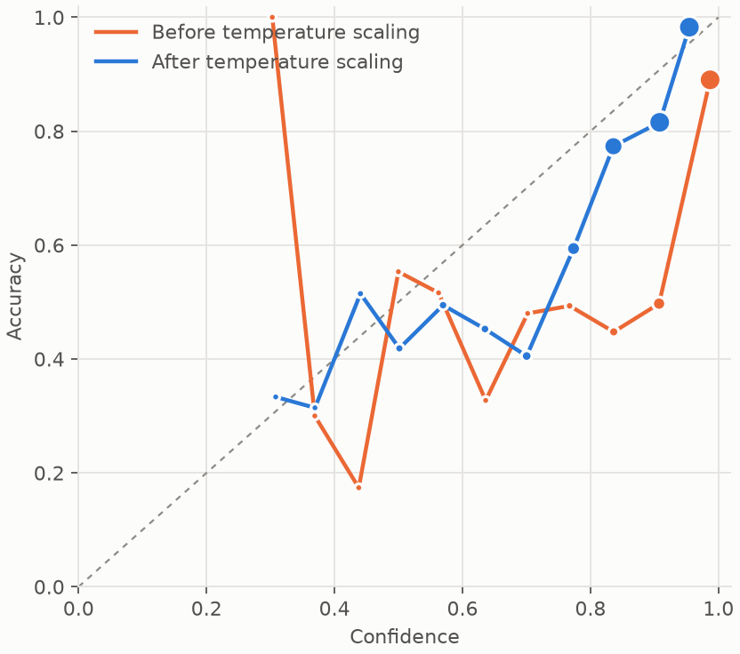

# Lahja: evaluation report

[Version française](evaluation.fr.md)

Corpus `open`. The model kept for the demo is **MARBERT**, chosen on the validation set. On the test set it reaches a macro-F1 of 80.8 %, against 70.8 % for the character n-gram baseline, a gain of 10.0 points. Every number below comes from `make evaluate` and is rewritten on each run.

## Acceptance thresholds

The model is exported and published only if all three thresholds hold.

| criterion | threshold | measured | met |
| :--- | :--- | ---: | :--- |
| gain of the fine-tuned model over the baseline (test macro-F1) | ≥ 5 points | 10.0 pts | yes |
| macro-F1 lost to int8 quantisation | ≤ 1 point | 0.32 pt | yes |
| demo latency, 95th percentile, CPU | < 300 ms per sentence | 24.0 ms | yes |

All three thresholds are met: `make publish` copies the quantised model to `models/release/`.

## The three models

Same training data, same split, same normalisation. The test set shares no source sentence, no TV show and no dictionary headword with the training set. The two ONNX rows are the selected model after export, in 32-bit floats and in 8-bit integers (the demo runs the latter).

| model | macro-F1 test (in-domain) | macro-F1 tweets (out-of-domain) | accuracy (test) | ECE test |
| :--- | ---: | ---: | ---: | ---: |
| Char n-grams + LR | 70.8 | 58.7 | 69.6 | 0.055 |
| CAMeLBERT-DA | 78.1 | 70.8 | 76.7 | 0.074 |
| MARBERT ★ | 80.8 | 78.7 | 79.6 | 0.077 |
| ONNX fp32 | 80.7 | 78.7 | 79.5 | 0.078 |
| ONNX int8 | 80.4 | 78.5 | 79.2 | 0.074 |

★ selected for the demo. Validation macro-F1: CAMeLBERT-DA 81.3, MARBERT 84.0.

Each fine-tuned model was also trained with other seeds, everything else unchanged. Mean ± standard deviation over the runs:

| model | seeds | macro-F1 test (in-domain) | macro-F1 tweets (out-of-domain) |
| :--- | ---: | ---: | ---: |
| CAMeLBERT-DA | 3 | 78.6 ± 0.5 | 71.3 ± 0.5 |
| MARBERT | 3 | 80.7 ± 0.3 | 76.3 ± 2.4 |

### Precision, recall and F1 per class (test)

| class | Char n-grams + LR P / R / F1 | CAMeLBERT-DA P / R / F1 | MARBERT P / R / F1 |
| :--- | ---: | ---: | ---: |
| Gulf | 58 / 73 / 65 | 64 / 80 / 71 | 68 / 81 / 74 |
| Levant | 76 / 60 / 67 | 86 / 63 / 73 | 85 / 70 / 77 |
| Egypt | 69 / 58 / 63 | 77 / 70 / 73 | 81 / 71 / 76 |
| Maghreb | 86 / 84 / 85 | 92 / 87 / 89 | 91 / 91 / 91 |
| MSA | 66 / 84 / 74 | 74 / 96 / 84 | 78 / 97 / 87 |

Each row adds up to 100: the share of a true class sent to each predicted class.

### Test score by corpus of origin

The test set mixes three corpora with very different registers. Macro-F1 over the classes that have at least 20 test sentences in each corpus (Maghreb left out of SADA, 2 sentences):

| model | FLORES-200 (n = 1,248) | Lahga (n = 323) | SADA (n = 1,178) |
| :--- | ---: | ---: | ---: |
| Char n-grams + LR | 68.9 | 62.3 | 52.7 |
| CAMeLBERT-DA | 83.2 | 68.9 | 60.1 |
| MARBERT | 84.7 | 81.3 | 64.2 |

FLORES-200 holds formal sentences translated from English Wikipedia, SADA holds TV dialogue, and Lahga holds short example sentences from a dictionary.

## Out-of-domain tests

These sets come from sources the models never saw in training. Predicting a class absent from a set (MSA, for instance) counts as an error, and macro-F1 averages over the classes present.

### tweets (out-of-domain)

Tweets with QADI country labels (QCRI), 1,000 per class, drawn at random among those of 3 to 60 words after normalisation. The corpus available with its text only covers Egypt, Lebanon, Libya, Morocco and Sudan (left out), so there is no Gulf class here. A tweet's label is its author's country, not a reading of the text: some of these tweets are in MSA. No tweet text is published, only the scores.

| model | macro-F1 | F1 Levant | F1 Egypt | F1 Maghreb |
| :--- | ---: | ---: | ---: | ---: |
| Char n-grams + LR | 58.7 | 67.8 | 71.8 | 36.5 |
| CAMeLBERT-DA | 70.8 | 79.8 | 84.8 | 47.8 |
| MARBERT | 78.7 | 86.3 | 87.5 | 62.4 |

MADAR is not part of this run: its licence requires a manual download (see the [full description](details.md#reproduce)). Once the files are in `data/raw/madar/`, `make evaluate` adds it here.

## Calibration

Expected calibration error (ECE, 15 bins) of the selected model on the test set: 0.140 before temperature scaling, 0.077 after. The temperature is fitted on the validation set only (T = 1.66 for the PyTorch model, 1.54 for the int8 model the demo runs). Scaling changes confidence, never the predicted class.

## Quantisation

Dynamic int8 quantisation of the weights with ONNX Runtime, after fusing attention and layer-norm ops. Test macro-F1: 80.73 % in fp32, 80.41 % in int8, a loss of 0.32 point. The file goes from 621 MB to 156 MB.

## CPU latency

300 test sentences sent one at a time, ONNX Runtime limited to 2 threads, which is what a free Hugging Face CPU Space provides (processor: AMD Ryzen 5 5600G with Radeon Graphics). The API path covers the whole request: validation, normalisation, tokenisation, inference and JSON.

| path | p50 (ms) | p95 (ms) |
| :--- | ---: | ---: |
| API `POST /predict` | 12.2 | 24.0 |
| model alone (int8) | 9.2 | 20.4 |
| API `POST /predict` with `explain` (word influence) | 100.0 | 590.4 |
| baseline (scikit-learn) | 0.5 | 0.6 |

Word influence removes each word in turn and measures what the predicted class loses, which costs one extra forward pass per word, batched together. The threshold applies to the plain prediction.

## What the baseline looks at

Character n-grams with the largest logistic-regression weight for each class, word edges removed and duplicates merged (`char_wb` n-grams carry the spaces around a word).

| class | n-grams |
| :--- | :--- |
| Gulf | `وش` `لا` `ايش` `يا` `مو` `اب` `ما` `هذ` `اللي` `تي` |
| Levant | `بت` `يلي` `هيك` `عم` `رح` `عال` `هيد` `نو` `مش` `حك` |
| Egypt | `دي` `بت` `ده` `ات` `بي` `هت` `وا` `لو` `ليه` `زي` |
| Maghreb | `اش` `كي` `كت` `باش` `ديا` `ديال` `فال` `برش` `بش` `تي` |
| MSA | `قد` `التي` `ان` `لتي` `او` `لم` `كما` `به` `ائ` `الذي` |

## Training

| model | device | duration | best epoch | validation macro-F1 by epoch |
| :--- | :--- | :--- | ---: | :--- |
| CAMeLBERT-DA | AMD Radeon Graphics (gfx1200, ROCm 7.2) | 2 min | 3 | 79.5, 80.9, 81.3 |
| MARBERT | AMD Radeon Graphics (gfx1200, ROCm 7.2) | 4 min | 3 | 82.0, 82.4, 83.9 |

Fine-tuning: full model, 3 epochs, batches of 32, AdamW with a learning rate of 3e-5, linear warm-up over 6 % of the steps then linear decay, weight decay 0.01, mixed precision, cross-entropy weighted by inverse class frequency, seed 13. The epoch kept is the best on validation. Baseline: TF-IDF on character n-grams of 2 to 5 (`char_wb`), logistic regression with balanced class weights, C = 10 chosen on validation.

